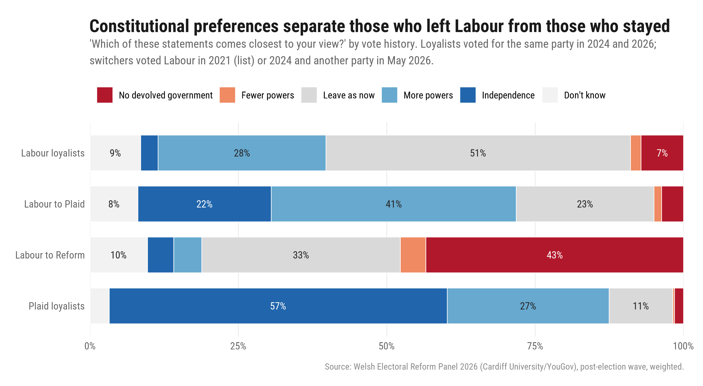
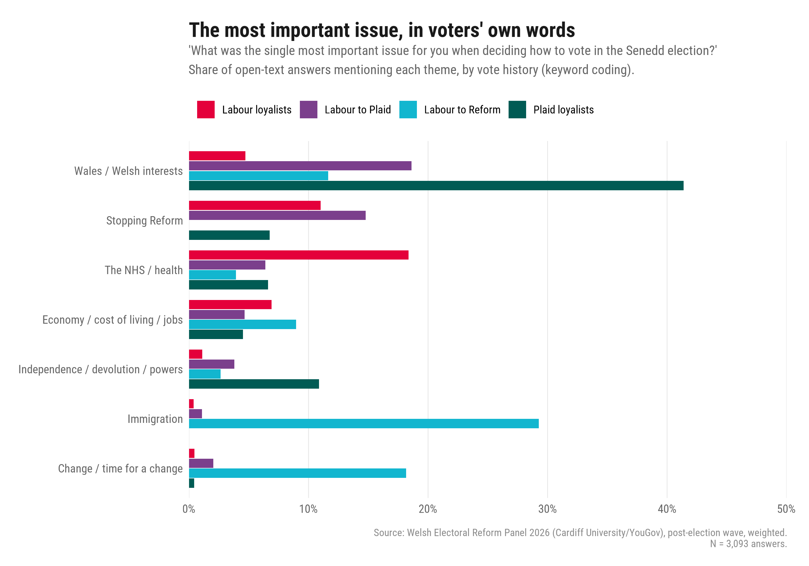
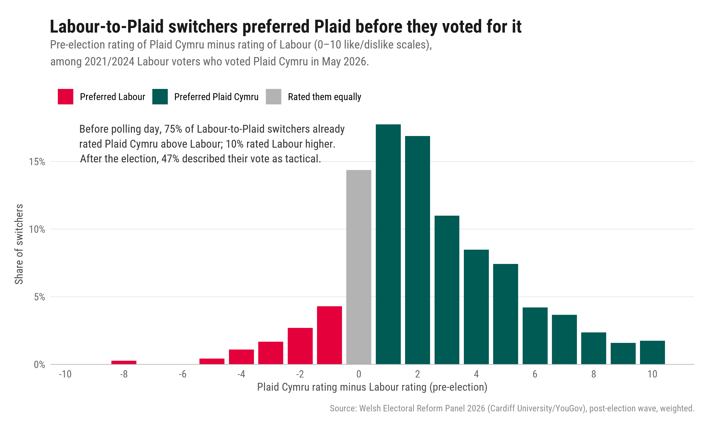
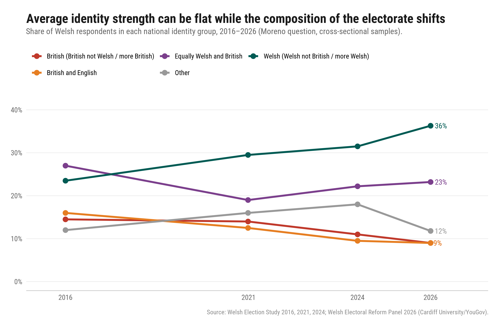
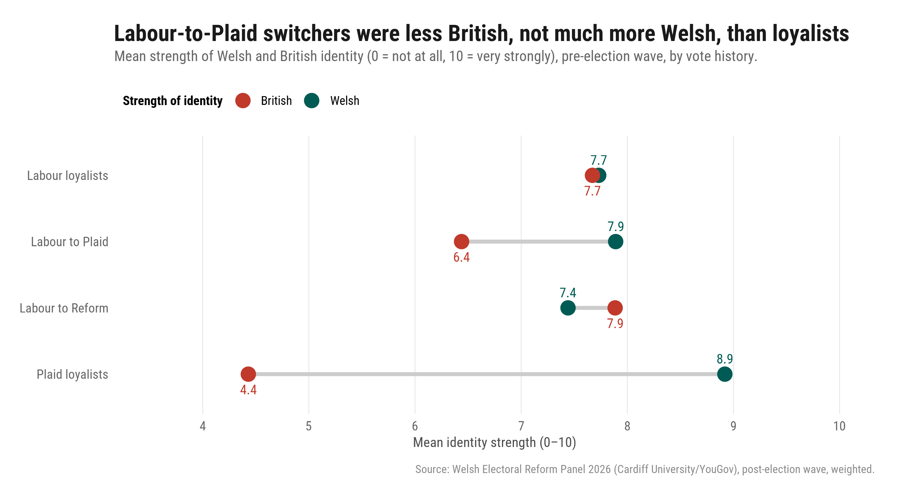
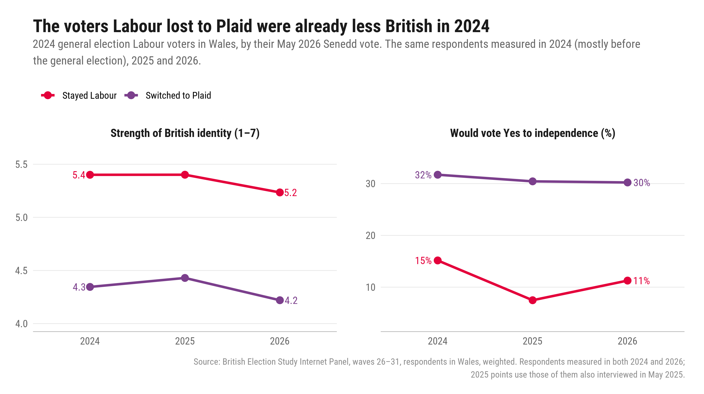

*A note on interests: before the review was commissioned, I was approached about carrying it out and sent a proposal, which was not taken forward. That was a reasonable decision: PF Global's review draws on focus groups and fieldwork I would not have had the capacity to run myself. I mention it in the interest of transparency.*

On Friday 20 November, in a letter to the First Minister, Prime Minister Andy Burnham said he was not persuaded by the case for devolving policing and justice, the Crown Estate or rail infrastructure to Wales ([BBC News](https://www.bbc.co.uk/news/articles/ck9874vydr83o)). It is a striking position from a Prime Minister who made his name as Mayor of Greater Manchester arguing that power should be pulled out of Whitehall. The decision puts Burnham at odds with Welsh Labour’s leader, Ken Skates, who a week earlier had told the BBC that devolving policing and the Crown Estate remained party policy, even as he told conference that Labour had focused on the issue too much in the past ([BBC News](https://www.bbc.co.uk/news/articles/crz9dx0jje7zo)).

Does any of this matter to the voters Welsh Labour needs to win back? The party’s own election review, [*The road back to victory*](https://www.welshlabour.wales/wp-content/uploads/2026/11/Welsh_Labour_Election_Review.pdf), published days earlier by a PF Global team, suggests not much. It found that demands over the Crown Estate and policing “did not speak to voters on the doorstep”, and that for most voters “standing up for Wales” means getting the NHS, the economy and the cost of living right. It is a serious piece of work, and much of it chimes with what our own survey data have shown since 2024.[^1]

In this post I want to focus on Burnham's decision to rule out more powers for Wales linking this to the PF Global review and to extend some of the related analysis presented in it. Chiefly, I'm interested in the question of whether constitutional issues matter to voters and what it means to "stand up for Wales" (along with a few related points). Most of the evidence here comes from the Welsh Electoral Reform Panel (hereafter “the panel”), a two-wave YouGov survey for Cardiff University carried out either side of the May election; details are in the note at the end.

## Did the constitution come up?

The review’s most discussed claim, in the media and at Welsh Labour’s conference, is that constitutional issues did not move voters (constitutional issues were notably absent in Welsh Labour's 2026 campaign, but the idea here is that in years prior they had played a more central role). Its main evidence is that voters did not raise them when asked which issues were important to them, and by that sensible test they did not: only 8% of Labour-to-Plaid switchers in the PF poll name devolution or independence as a top issue. Our panel’s open-text data agree. Asked for the single most important issue in deciding their vote, only 4% of switchers mentioned independence, devolution, powers or Westminster. 

The risk, which looked real at conference, is that the party concludes from this that voters don’t care about these questions and that it should stop pressing for further devolution. That is not what the review recommends, and it gives the case for further devolution more space than much of the coverage suggested. It says its focus on delivery “does not mean stepping back from institutional or constitutional questions”, notes that almost half of switchers want a stronger Senedd, and calls for Welsh Labour to have meaningful influence over UK decisions affecting Wales. It advises seeking further powers “where they would improve delivery”, saying what each would deliver rather than debating powers in the abstract. It even suggests Burnham’s emphasis on devolution might suit that approach. Burnham’s letter on Friday rather undercuts that hope: the powers it rules out include the very ones Skates had said remained party policy.

Here I would emphasise that salience and structure are different things, and the review recognises as much when it notes that switchers are nonetheless “open to change” on the constitution. I believe a more useful question than whether voters talked about the constitution is whether constitutional preferences distinguish the voters Labour lost from those it kept. Figure 1 suggests they do.

*Figure 1. Constitutional preferences by vote history.*

Among Labour loyalists, half want the devolution settlement to stay as it is and 3% support independence. Among those who switched from Labour to Plaid in May, 41% want more powers for the Senedd and a further 22% want independence. In a referendum tomorrow, 9% of loyalists would back independence, against 34% of switchers. These are not Plaid’s core voters, 57% of whom choose independence outright, but they are the voters Labour needs back if it is to return to power.

The review’s own data show the same pattern. Its Figure 5.2 has 49% of switchers wanting a stronger Senedd within the UK and 26% wanting independence, against 40% and 12% among 2026 Welsh Labour voters. On either survey, between two-thirds and three-quarters of the people Labour lost to Plaid want more self-government than Wales has now. Both sets of figures were measured after these voters had moved, so it is fair to ask which came first. I return to that below.

Scotland offers a useful comparison here. Few would dispute that the constitution has structured Scottish party competition since the independence referendum. Yet after the 2016 Holyrood election, less than two years after the referendum, only 14% of Scottish Election Study respondents named independence, a referendum, the union or anything else constitutional as the most important issue in their vote. At the 2017 general election, when the SNP lost 21 seats as unionist voters consolidated behind the Conservatives, it was 8%. Nobody would conclude that the constitution did not matter in Scotland in those years or that voters were unmoved by these issues. It was the axis around which the party system had reorganised; it simply did not present itself as an issue voters used to justify their vote.[^2] Wales is very different, but the point stands: that voters don’t mention the constitution does not mean constitutional preferences haven’t shaped their choices and may continue to do so.

## What voters think ‘standing up for Wales’ means

The review’s second claim is more specific. It recognises the importance of being seen to stand up for Wales, but argues that this can be defined as delivery on key policy areas: “for most voters, ‘standing up for Wales’ still means getting those everyday, left-of-centre priorities right”.

That is a claim about what the phrase means to voters, and the review does not measure it directly. It infers it from issue-importance questions, on which the NHS and the cost of living come top for almost every group in almost every survey. Its own polling hints that the two are not the same: Welsh Labour trails Plaid by four or five points on the NHS and the economy, but by 28 points on standing up for Wales (its Figure 4.4). If voters judged standing up for Wales mainly on delivery, those gaps would look more alike.

When the question itself is asked, the evidence points in a different direction. In the post-election wave of the panel, respondents were asked what it means for a political party to stand up for Wales, in their own words, with no prompts and just an open text box (thanks to James Griffiths for this one). Figure 2 shows the themes they raised, coded by keyword, for Labour loyalists, Labour-to-Plaid switchers and Plaid loyalists.

*Figure 2. What voters say ‘standing up for Wales’ means, by vote history.*

The NHS appears in 3% of switchers’ answers; the economy, cost of living and public services together in 7%. The themes that dominate are relational and territorial: Wales’s position relative to Westminster and the UK Government (19%), a fair share of funding, with HS2 coming up a surprising amount (17%), having a voice and not being taken for granted (14%), and language, culture and identity (12%). Explicit demands for powers or independence are rarer (6%), consistent with their low salience. Around a third of every group answered “don’t know”, a reminder that for many voters the phrase is a slogan rather than a programme.

Two things stand out. First, switchers look much more like Plaid loyalists than Labour loyalists on every territorial theme; the only themes on which loyalists score higher are the NHS and the economy. Second, even among loyalists, the delivery reading of the phrase is a minority one. That is not to say the NHS didn’t matter to these voters; it plainly did. They just don’t think of competence on the NHS as what standing up for Wales means.

The most-important-issue question tells a complementary story (Figure 3). For Labour loyalists, the NHS was the most mentioned issue (18%), ahead of stopping Reform (11%). For Labour-to-Plaid switchers, the most mentioned theme was Wales itself: Welsh interests, a Welsh party, a party that puts Wales first (19%), followed by stopping Reform (15%), with the NHS at 6%. For Plaid loyalists, Wales dominates (41%). Among those who left Labour for Reform, immigration (29%) and a desire for change (18%) lead, though this is a small group in our sample (98 respondents) and those figures are less precise.

*Figure 3. The single most important issue, in voters’ own words, by vote history.*

This helps reconcile the review’s finding that the constitution did not come up with Figure 1. In its narrow sense, “the constitution” means institutional questions: which powers sit where, how the Senedd is funded, whether policing or the Crown Estate should be devolved. These are technical and rarely salient, and the review is right that they did not move votes in May. But the themes that dominate the open-text answers (that Wales is shortchanged by Westminster, not listened to, denied its fair share) clearly resonate, and constitutional preferences plausibly grow out of that kind of grievance rather than the other way round. Among respondents who framed standing up for Wales in terms of Westminster, fair funding or being heard, 60% want more powers for the Senedd or independence. Among those who framed it only in terms of the NHS, the economy or public services, 28% do. The relationship holds among previous Labour voters taken on their own. This is why the form of Friday’s ‘no’ may matter more than its substance. Few voters have firm views on who should manage the Crown Estate (and I doubt many know what it is...it is quite odd if you look it up), but a Labour Prime Minister turning down Wales’s requests is easily read as Wales not being listened to: exactly the kind of territorial grievance switchers raised most often.

## Were these tactical votes?

The review places considerable weight on tactical voting. 60% of its Labour-to-Plaid switchers say “tactical voting and the new system” contributed to Labour’s defeat; 51% gave stopping Reform as a reason for choosing Plaid; and in a straight choice between Welsh Labour and Reform UK, Labour leads 41% to 34%. From this it concludes that many of these voters are recoverable if Labour can again be seen as the way to keep Reform out.

Our panel offers similar support. Asked the main reason for their vote, 47% of switchers chose “it was a tactical vote, to stop another party winning in my constituency”, and almost all of them named Reform as the party they wanted to stop.

But most switchers also genuinely liked Plaid Cymru, and in most cases preferred it to Labour. In our panel, switchers rated Plaid above Labour on 0–10 like/dislike scales for months before the election (Figure 4), as documented in our [analysis of the election](https://www.cardiff.ac.uk/news/view/3046565-the-senedd-election-result-no-return-to-business-as-usual) and, before it, in [our reading of the pre-election polling](https://blogs.cardiff.ac.uk/thinking-wales/consolidation-not-conversion-understanding-waless-ongoing-realignment).

*Figure 4. Pre-election rating of Plaid Cymru minus rating of Labour among Labour-to-Plaid switchers.*

Some have argued that this was a reaction to the Caerphilly by-election, which convinced many voters that the Senedd election was a contest between Plaid Cymru and Reform UK. Some who decided to back Plaid as the surest way to stop Reform may then have brought their ratings of the parties into line with that decision. The British Election Study Internet Panel lets us test this, because it has interviewed the same people in Wales repeatedly since before the 2024 general election. Figure 5, from analysis by my colleague [James Griffiths](https://bsky.app/profile/jamesdgriffiths.bsky.social), tracks how the voters Labour lost to Plaid in May 2026 rated the two parties over the previous two years.

*Figure 5. Like/dislike ratings of Labour and Plaid Cymru, May 2024 to May 2026, by vote history (British Election Study Internet Panel).*

In July 2024, just after the general election, these voters rated Labour a point above Plaid on average on a 0–10 scale, and 57% preferred Labour against 23% who preferred Plaid. By May 2025, five months before Caerphilly, that lead had gone. Almost all of the change came from Labour: their view of Plaid barely moved over the same year (6.2 to 6.1). Plaid’s rating only rose after that, to 7.3 by May 2026, by which point 68% preferred Plaid.

So Caerphilly may well have helped turn disillusionment with Labour into enthusiasm for Plaid, and it made Plaid the obvious home for anti-Reform votes. But it did not start the switch. These voters fell out with Labour during the first year of a Labour UK Government and a period of considerable turmoil for the Welsh Government, months before the by-election. That fits the review’s own evidence: most switchers told PF Global their view of Welsh Labour had changed gradually, and the party’s canvassing records show its support falling sharply during Keir Starmer’s first year. What the panel adds is that views of Labour moved first, and that by polling day these voters were not making a reluctant loan but voting for the party they liked best. The clear danger for Welsh Labour here is that without clear differentiation from the UK party they will continue to pay a price for a UK Labour government's unpopularity (or, if one were to be optimistic at this point in time, benefit from its popularity). Burnham’s letter makes that differentiation both harder and more necessary: Welsh Labour must now either accept a ‘no’ from its own side in London or be seen to argue with it.

## Identity: level versus composition

The review argues the result was “not necessarily” about Welsh identity, because average Welsh identity strength in the British Election Study panel has been flat for a decade. It is careful to add that identity is not irrelevant: switchers score more strongly on Welsh identity than those who stayed, and its focus groups heard complaints about Labour not “standing up for Wales as a separate entity”. But it reports that switchers “feel as Welsh as Plaid’s core voters” and concludes that for most voters identity works through delivery.

This is where I would more firmly disagree with the report. Welsh identity has indeed not grown, but the review draws the wrong inference, because it looks only at Welsh identity. British identity, it says, has “remained relatively stable, with any decline at broadly the same rate in every nation of Great Britain”. In our [recent paper in the British Journal of Political Science](https://www.cambridge.org/core/journals/british-journal-of-political-science/article/reshaping-belonging-national-identity-change-in-postreferendum-britain/F18B7F4D8CAFB79BAADA40DCD8C87ACC), James Griffiths, Dan Wincott and I show that the Brexit referendum produced a lasting fall in British identification among those on the losing side, with no matching change in Welsh identification. People did not become more Welsh; they became less British. In a country where most voters hold both identities, that is consequential (Figure 6 shows the share describing themselves as more Welsh than British). A decline at the same rate everywhere can still matter more in Wales, where a credible party is well placed to speak to it.

*Figure 6. Share of respondents in each national identity group, 2016 to 2026.*

The review’s second point, that switchers “feel as Welsh as Plaid’s core voters”, is not one our data reproduce, but this may be a result of different scales of national identity used (it seems PF Global used a 1–7 scale similar to the British Election Study, whereas we used a 0–10 scale, similar to previous Welsh Election Studies). Figure 7 shows mean strength of Welsh *and* British identity, measured in the same survey before the election, by vote history.

*Figure 7. Mean strength of Welsh and British identity by vote history.*

Switchers are slightly more Welsh than Labour loyalists (7.9 against 7.7) but considerably less British (6.4 against 7.7). Plaid loyalists sit well beyond them on both counts (8.9 and 4.4). On the Moreno measure of national identity, 29% of switchers describe themselves as Welsh not British, against 12% of loyalists and 54% of Plaid loyalists. What distinguishes the voters Labour lost to Plaid from those it kept is not a stronger attachment to Wales but a weaker attachment to Britain.

## Which came first?

An obvious objection to Figures 1 and 7 is that causation may run the other way. People often bring their views into line with the party they support, so switchers might have become less British and keener on more powers because they had moved to Plaid, rather than moving because of those views.

The British Election Study panel lets us check, because it asked the same people about their identity and the constitution in 2024, mostly in May, before the general election. Figure 8 follows 2024 Labour voters in Wales who went on to vote Labour or Plaid in the 2026 Senedd election (349 respondents with a 2024 identity measure, 203 of whom switched).

*Figure 8. British identity and support for independence among 2024 Labour voters, 2024 to 2026, by 2026 Senedd vote (British Election Study Internet Panel).*

Those who switched to Plaid were already markedly less British in 2024 than those who stayed (4.3 against 5.4, on a 1 to 7 scale), and twice as likely to say they would vote for independence (32% against 15%). Over the next two years both groups became slightly less British, by almost exactly the same amount. Britishness in 2024 also predicts who went on to switch, even after taking into account how much people liked Labour and Plaid at the time: three quarters of those with weaker British identities (4 or below) went to Plaid, against fewer than half of those who felt very strongly British.

In June 2024 the eventual switchers were more likely to want more powers for the Senedd or independence (56% against 37%), and Labour voters who held those views were more likely to go to Plaid (70% against 52%).

This also clarifies what the longer-run fall in Britishness does and does not explain. It did not make these voters switch in 2026, since those who stayed with Labour became less British too. What it has done over the past decade is enlarge the pool of Labour voters with only a weak attachment to Britain, and when Labour’s standing fell in 2024 and 2025, those were the voters who left. What the evidence does not support is the idea that switchers only acquired these identities and views after deciding to vote Plaid.

## Conclusions

The review gets plenty right, and as it says itself, nobody in Labour should think they can parrot Plaid Cymru and reclaim their place as the hegemonic party of Welsh politics. Delivery matters, and the growing perception that Labour was failing on delivery was critical. But delivery is never judged in a vacuum. Voters read it through their prior attachments, and the voters Labour lost to Plaid are less attached to Britain than those it kept, with more voters like them than there used to be.

The review asks Welsh Labour to value Wales’s cultural identity but to show it through public services and delivery rather than “constitutional tests”. Yet most of what voters describe when asked what standing up for Wales means is neither delivery nor a constitutional test. That is much closer to the review’s own first recommendation, that Welsh Labour should be able to “make a distinct Welsh case where priorities differ” from UK Labour.

Delivery of course matters. But it is more than noteworthy that between 2010 and 2024 public services in Wales were rarely seen as performing well, and yet Welsh Labour kept winning. Part of the reason was distance from London: with the Conservatives in power at Westminster, Welsh Labour could stand up for Wales against a UK Government, and many voters blamed London rather than Cardiff for the state of public services (see note 2). That cover went in July 2024. Plaid Cymru, now governing in Cardiff with Labour in Downing Street, will be more than willing to play the same game, and Friday’s letter hands it the material to do so.

Plaid will, of course, now be judged on its own delivery of key services, and Labour may have an opportunity there. But a party that isn’t seen to stand up for Wales may find its successes discounted and its failures counted twice.

So, will Burnham’s decision help Welsh Labour win back votes? Probably not among the voters it lost to Plaid Cymru, and it may well hurt. The review’s emphasis on delivery might suggest the letter makes little difference either way, but these voters are not indifferent. Most of them want more self-government than Wales has now (though short of independence). When asked what standing up for Wales means, they mostly talk about Wales’s relationship with Westminster, a fair share and being listened to. And they fell out with Labour during the first year of a Labour UK Government. A Labour Prime Minister turning down the Senedd’s requests speaks directly to all three. It also leaves Ken Skates defending, as party policy, powers his own Prime Minister has just refused. Labour’s remaining voters, half of whom are content with the current settlement, are unlikely to be troubled by it. But they are not the voters the party needs to win back.

## Note on data

*The Welsh Electoral Reform Panel is a two-wave online panel conducted by YouGov for Cardiff University, with a pre-election wave fielded 13 to 30 April 2026 (N = 3,857) and a post-election wave fielded 13 to 31 May 2026 (N = 3,604; 2,919 in both waves). All figures are weighted to be representative of adults in Wales. Comparisons with earlier years use the Welsh Election Study 2016, 2021 and 2024. “Labour loyalists” voted Labour at the 2024 general election and Welsh Labour in May 2026; “Labour to Plaid” and “Labour to Reform” voted Labour at the 2021 Senedd (list) or 2024 general election and Plaid Cymru or Reform UK in May 2026; “Plaid loyalists” voted Plaid Cymru in 2024 and 2026. Answers about the EU referendum are excluded from the constitutional category. Figures from the Welsh Labour review are taken from The road back to victory (PF Global, November 2026), based on a poll of 1,387 adults in Wales fielded 29 August to 9 September 2026. Figure 5 uses the British Election Study Internet Panel, waves 26 to 31 (May 2024 to May 2026): respondents in Wales who voted Labour or Plaid Cymru at the 2024 general election, grouped by their 2026 Senedd vote and weighted using the wave 31 weight. Figure 8 uses the same British Election Study respondents who voted Labour at the 2024 general election, with British identity and independence vote intention first measured in waves 26, 27 or 29 (May to July 2024, mostly May) and again in waves 30 and 31; devolution preference comes from wave 27 (June 2024). Estimates of whether 2024 attitudes predict switching come from weighted logistic regressions that also control for 2024 Welsh identity, 2024 like/dislike ratings of Labour and Plaid, and demographics.*

[^1]: For example, the review finds Welsh Labour’s collapse came when Labour governed at both levels for the first time since 2010, and the party lost far more support to Plaid Cymru than to Reform UK. The “long-term progressive drift” the review identifies, voters who back Labour at Westminster but not at the Senedd and who are younger, more often women, on lower incomes and more Welsh than British, is the dual partisan that Welsh electoral research has described since the [first Assembly election](https://ora.ox.ac.uk/objects/uuid:91835c31-8ac1-4327-b6e4-29bec69a3d6b). Our analysis of the [2021 Senedd election](https://doi.org/10.1093/pa/gsac012) identified them as the group on which Labour’s future depended. The review’s verdict that the “Red Welsh Way” meant little to voters, and that the campaign moved between it and “Power in Partnership” without a clear policy offer, also fits our reading: Welsh Labour spent most of the term stepping away from the differentiation strategy that had sustained it for a quarter of a century. The review puts this down to the Red Welsh Way being tied up in constitutional positioning rather than everyday policy; I would put more weight on how late the pivot came. But we agree it did not land.

[^2]: This is contested territory in the political science and survey literature, but my view is that if you ask voters why they voted, they will give an issue-shaped reason (a waiting list, a road, a school closure), because the question invites a justification and that kind is easier to give than “I stopped feeling the party was on my side”. Such questions, including our own, measure salience well and weight less well (see [Nisbett and Wilson](https://doi.org/10.1037/0033-295X.84.3.231), [Zaller](https://www.cambridge.org/core/books/nature-and-origins-of-mass-opinion/70B1485D3A9CFF55ADCCDD42FC7E926A) and [Achen and Bartels](https://press.princeton.edu/books/paperback/9780691178240/democracy-for-realists)). The NHS complaints are real, and voters did hold the Welsh Government responsible for them. But whether a voter blames Cardiff or London depends on prior attachments: for years, strong Welsh identifiers tended to blame Westminster for poor devolved outcomes, which is partly why Welsh Labour could govern through fourteen years of strained public services without paying the full price.
