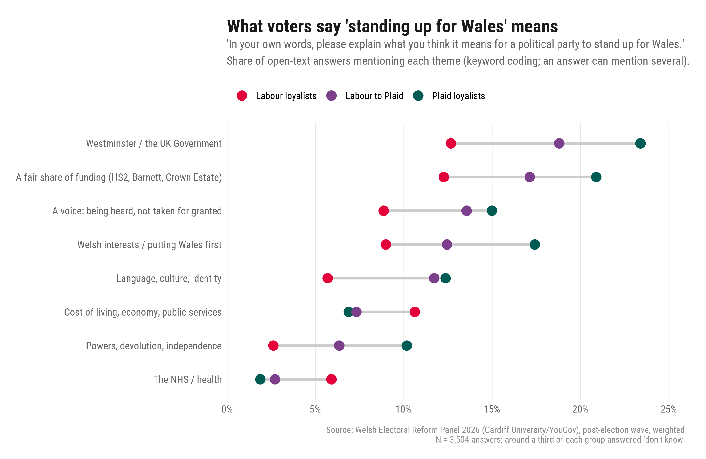
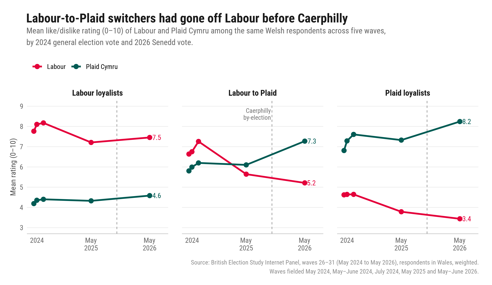

*A note on interests: before the review was commissioned, I was approached about carrying it out. I sent a proposal, which was not taken forward. That was a reasonable decision. The review PF Global produced draws on focus groups and fieldwork that I would not have had the capacity to run myself, and I would have needed to rely on substantial outside help. I mention it in the interest of transparency, and so readers can apply whatever discount for sour grapes they think appropriate.*

Welsh Labour has published the independent review it commissioned into its defeat at the May 2026 Senedd election. Written by a team at PF Global led by Professor Anand Menon, [*The road back to victory*](https://www.welshlabour.wales/wp-content/uploads/2026/11/Welsh_Labour_Election_Review.pdf) draws on a new poll of 1,387 adults in Wales, twenty interviews, 161 member submissions, two focus groups and the party's own canvassing records. It is a serious piece of work and much of it chimes with what our own survey data have been showing since 2024.

In this blog I wanted to pay a bit more attention to some of the central claims in the report which have subsequently been the focus of much of the party’s own internal discussions and media commentary: namely, that constitutional demands, such as transferring the Crown Estate and devolving policing, "did not speak to voters on the doorstep": and that for most voters, "standing up for Wales" means getting the NHS, the economy and the cost of living right. AS a result, it has been suggested that Welsh Labour should define the phrase in those terms and compete on that ground.

In this post I’ll mostly use data from the Welsh Electoral Reform Panel (referred to henceforth as the panel), a two-wave survey of 3,857 adults before the election and 3,604 after it, carried out by YouGov for Cardiff University. 

## Points of agreement

Much of the review's account is well supported by multiple data sources. Welsh Labour’s collapse came when Labour governed at both levels of administration for the first time since 2010 and the party did not lose substantial support to Reform UK but rather lost far more support to Plaid Cymru.

The review's "long progressive drift" identified in the review of voters who back Labour at Westminster but not at the Senedd and who are younger, more often women, on lower incomes and more Welsh than British, is the dual partisan that Welsh electoral research has described since the [first Assembly election](https://blogs.cardiff.ac.uk/thinking-wales/consolidation-not-conversion-understanding-waless-ongoing-realignment/) and that our analysis of the [2021 Senedd election](https://doi.org/10.1093/pa/gsac012) identified as the group on which Labour's future depended. Similarly, the review’s verdict that the "Red Welsh Way" came late and was overshadowed by "Power in Partnership" also matches our reading that Welsh Labour spent most of the term stepping away from the differentiation strategy that had sustained it for a quarter of a century and the last minute pivot was not enough.

## Did the constitution come up?

Perhaps the aspect of the review which received the most scrutiny and certainly was discussed very widely in the media surrounding the report and Welsh Labour’s conference was the question about whether constitutional meant anything to voters. Here, the review's test for whether the constitution mattered was whether voters raised it. By that, quite sensible, test it did not: only 8% of Labour-to-Plaid switchers in the PF poll name devolution or independence as a top issue, and it concludes that demands over the Crown Estate and the devolution of policing "did not speak to voters on the doorstep". Our panel’s open-text data support this. Asked for the single most important issue in deciding their vote, only 4% of Labour-to-Plaid switchers mentioned independence, devolution, powers or Westminster. It is, frankly, quite an odd thing for someone to name this as a top issue for them.

However, there is a risk, as appeared to be apparent during Welsh Labour’s conference, that the party incorrectly concludes that people do not care about these topics and that the party should therefore cease focusing on further devolution to the Senedd as a result.[^1]

Here, I want to make the point that salience and structure are different things. For Welsh Labour, I would argue a more useful question is not whether voters talked about the constitution but rather whether constitutional preferences distinguish the voters Labour lost from the voters it kept. Figure 1 suggests that this is very much the case.

*Figure 1. Constitutional preferences by vote history.*

Among Labour loyalists, half want the devolution settlement to remain as it is, while 3% support independence. Among those who switched from Labour to Plaid Cymru in May, 41% want more powers for the Senedd and a further 22% want independence. Asked how they would vote in a referendum tomorrow, 9% of loyalists would back independence; the figure among Labour-to-Plaid switchers the figure is 34%. These are not Plaid's core voters, 57% of whom choose independence outright, but they are the voters Labour will need to win back if it is to return to power in Wales.

The review's own data show the same pattern. Its Figure 5.2 has 49% of Labour-to-Plaid switchers wanting a stronger Senedd within the UK and 26% wanting independence, against 40% and 12% among those who voted Welsh Labour in 2026. Three quarters of the people Labour lost to Plaid want more self-government than Wales has now. While Labour’s residual vote is somewhat less supportive of further devolution, the point remains that the voters it needs to win back are those who are much more sympathetic to constitutional change. Both sets of figures measure attitudes in 2026, after these voters had already moved, so it is fair to ask which came first. I return to that question below.

An additional useful point here is a comparison with Scotland. Few would dispute that the constitution has structured Scottish party competition in the aftermath in the Scottish Independence Referendum. Yet when the Scottish Election Study asked voters after the 2016 Holyrood election, less than two years after the independence referendum, what the most important issue was in deciding their vote only 14% mentioned independence, a referendum, the union or anything relating to Scotland's constitutional future. At the 2017 general election, when the SNP lost 21 seats as unionist voters consolidated behind the Conservatives, it was just 8%. Nobody would conclude from these figures that the constitution did not matter in Scotland in 2016 or 2017. It was the axis around which the party system had reorganised but it simply did not present itself to voters as an issue they used to justify their vote. Wales is very different to Scotland, but the point stands that even if voters do not mention the constitution, it does not mean that constitutional preferences haven’t shaped their electoral choices.[^2]

## What voters think 'standing up for Wales' means

The review's second claim is more specific. While recognising the importance of being perceived to be “standing up for Wales” its recommendations argue that this can be defined as being about delivery on key policy areas: "for most voters, 'standing up for Wales' still means getting those everyday, left-of-centre priorities right".

That is a claim about what the phrase means to voters, and the review does not measure it directly. It infers it from issue-importance questions, on which the NHS and the cost of living come top for almost every group of voters in almost every survey. When my [colleague James Griffiths](https://bsky.app/profile/jamesdgriffiths.bsky.social) has asked the question itself the evidence points heavily in a different direction. In the post-election wave of the panel, respondents were asked what it means for a political party to stand up for Wales in their own words (so no prompts, just an open text box). Figure 2 shows the themes they raised, coded by keyword, for Labour loyalists, Labour-to-Plaid switchers and Plaid loyalists.

*Figure 2. What voters say 'standing up for Wales' means, by vote history.*

The NHS appears in 3% of switchers' answers. The economy, cost of living and public services together appear in 7%. The themes that dominate are relational and territorial: Wales's position relative to Westminster and the UK Government (19%), a fair share of funding, with HS2 coming up a surprising amount (17%), having a voice and not being taken for granted (14%), and language, culture and identity (12%). Explicit demands for powers or independence are rarer (6%), which is consistent with the low salience noted above. Around a third of every group answered "don't know", a reminder that the phrase is a slogan for many voters rather than a programme.

Two things stand out. First, Labour-to-Plaid switchers look much more like Plaid loyalists than like Labour loyalists on every territorial theme, and the only themes on which loyalists score higher are the NHS and the economy. Second, even among loyalists, the delivery reading of the phrase is a minority one. The review's claim that standing up for Wales means the NHS is not supported by what voters say when asked. That is not to say the NHS didn’t matter to these voters because it plainly did. They just don’t think of competence on the NHS as what standing up for Wales means.

Our survey’s “most-important-issue” question tells a complementary story (Figure 3). For Labour loyalists, the NHS was the single most mentioned issue (18%), ahead of stopping Reform (11%). For those who left Labour for Plaid, the most mentioned theme was Wales itself: Welsh interests, a Welsh party, a party that puts Wales first (19%), followed by stopping Reform (15%), with the NHS at 6%. For Plaid loyalists, Wales dominates (41%). For those who left Labour for Reform, immigration (29%) and a desire for change (18%) lead, although this is a small group in our sample (98 respondents) and those figures are less precise.

*Figure 3. The single most important issue, in voters' own words, by vote history.*

This helps to reconcile the review's finding that the constitution did not come up with the evidence in Figure 1 that constitutional preferences divide Labour to Plaid switchers from Labour loyalists. When asked about directly, "the constitution" means institutional questions: which powers should sit where, how the Senedd should be funded, whether policing or the Crown Estate should be devolved. These are technical questions, are rarely salient, and the review is right that they did not move votes in May. But the themes that dominate the open-text answers in our surveys: principally that Wales is shortchanged by Westminster, is not listened to, is denied its fair share, do resonate with voters. Constitutional preferences plausibly grow out of this kind of grievance rather than the other way round. Among respondents whose answers framed standing up for Wales in terms of Westminster, fair funding or being heard, 60% want more powers for the Senedd or independence; among those whose answer was framed only in terms of the NHS, the economy or public services, the figure is 28%. The relationship is the same among previous Labour voters taken on their own.

## Were these tactical votes?

The review places considerable weight on tactical voting. Sixty per cent of its Labour-to-Plaid switchers cite tactical voting as a factor in Labour's defeat; 51% gave stopping Reform as a reason for choosing Plaid; and in a straight choice between Welsh Labour and Reform UK, Labour leads 41% to 34%. From this it concludes that many of these voters are recoverable if Labour can again be seen as the way to keep Reform out.

The panel's post-election wave offers similar support on this measure. Asked the main reason for their vote, 47% of Labour-to-Plaid switchers chose "it was a tactical vote, to stop another party winning in my constituency", and almost all of them named Reform as the party they wanted to stop.

However, it should also be stressed that for most Labour to Plaid switchers there was also a genuine like of Plaid Cymru (and in most cases those voters preferred Plaid to Labour). Among previous 2021 and 2024 Labour voters, Plaid Cymru were consistently rated higher on 0-10 ‘likeability’ scales for months prior to the election, as shown in Figure 4 and documented in our [analysis of the election](https://www.cardiff.ac.uk/news/view/3046565-the-senedd-election-result-no-return-to-business-as-usual) and, before it, in [our reading of the pre-election polling](https://blogs.cardiff.ac.uk/thinking-wales/consolidation-not-conversion-understanding-waless-ongoing-realignment).

*Figure 4. Pre-election rating of Plaid Cymru minus rating of Labour among Labour-to-Plaid switchers.*

It's possible that this was a reaction to the Caerphilly by-election, which convinced many voters that the Senedd election was a contest between Plaid Cymru and Reform UK (a claim frequently made in news coverage of the election result). Some who had decided to back Plaid as the surest way to stop Reform may have brought their ratings of the parties into line with that decision. The British Election Study Internet Panel lets us test this, because it has been interviewing the same people in Wales repeatedly since before the 2024 general election. Figure 5 shows analysis from James Griffiths (mentioned above) and tracks how the voters Labour lost to Plaid in May 2026 rated the two parties over the two years before.

*Figure 5. Like/dislike ratings of Labour and Plaid Cymru, May 2024 to May 2026, by vote history (British Election Study Internet Panel).*

In July 2024, just after the general election, Labour to Plaid switchers rated Labour a point above Plaid on average on a 0-10 scale, and 57% preferred Labour against 23% who preferred Plaid. By May 2025, five months before Caerphilly, that lead had gone and Labour were already rated less favourably than Plaid Cymru. Almost all of that change came from Labour: their view of Plaid barely moved over the same year (6.2 to 6.1). Plaid's rating among them only rose after that, to 7.3 by May 2026, by which point 68% preferred Plaid.

So Caerphilly may well have helped turn disillusionment with Labour into enthusiasm for Plaid, and it made Plaid the obvious home for anti-Reform votes. But it did not start the switch. These voters had fallen out with Labour during the first year of a Labour UK Government, months before the by-election, and by polling day they were not describing a reluctant loan but voting for the party they liked the most.

## Identity: level versus composition

The review's final argument on this point is that the result was "not necessarily" about Welsh identity, because identity has not changed: average Welsh identity strength in the British Election Study panel has been flat for a decade. It is careful to add that identity is not irrelevant. Those who left Labour for Plaid score more strongly on Welsh identity than those who stayed, and its focus groups heard complaints about Labour not "standing up for Wales as a separate entity". But it reports that Labour-to-Plaid switchers "feel as Welsh as Plaid's core voters” and concludes that for most voters identity works through delivery.

This is where I part company with the report. While the review is correct about the measurement of identity, I think it draws the wrong inference from it, because it focuses on the wrong national identity. The review notes that British identity has declined "at broadly the same rate in every nation of Great Britain" but it then doesn't follow through on the role this decline in British identity had on Welsh politics. In our [recent paper published in the British Journal of Political Science](https://www.cambridge.org/core/journals/british-journal-of-political-science/article/reshaping-belonging-national-identity-change-in-postreferendum-britain/F18B7F4D8CAFB79BAADA40DCD8C87ACC) James Griffiths Dan Wincott and I show that the Brexit referendum produced a lasting fall in British identification among those on the losing side, with no matching change in Welsh identification. People did not become more Welsh. They became less British, and in a country where most voters hold both identities, this is consequential (see share of voters describing themselves as more Welsh than British in Figure 6).

*Figure 6. Share of respondents in each national identity group, 2016 to 2026.*

I think the review’s second point, that Labour-to-Plaid switchers "feel as Welsh as Plaid's core voters", potentially misses another dimension. Figure 7 shows mean strength of Welsh *and* British identity, measured before the election, by vote history.

*Figure 7. Mean strength of Welsh and British identity by vote history.*

Labour-to-Plaid switchers are slightly more Welsh than Labour loyalists (7.9 against 7.7) but importantly considerably less British (6.4 against 7.7). Plaid loyalists sit well beyond them on both counts (8.9 and 4.4). On the Moreno measure, 29% of switchers describe themselves as Welsh not British, against 12% of loyalists and 54% of Plaid loyalists. What distinguishes the voters Labour lost to Plaid from those it kept is not a stronger attachment to Wales but weaker attachment to Britain.

## Which came first?

An obvious objection to Figures 1 and 7 is that they may have the direction of causation the wrong way round. Both compare groups defined by how they voted in 2026, using attitudes measured in April 2026, by which point, as Figure 5 shows, these voters had been drifting away from Labour for a year. People often bring their views into line with the party they support, so switchers might have become less British and keener on independence because they had moved to Plaid, rather than moving to Plaid because of those views.

The British Election Study panel lets us check this, because it asked the same people about their identity and the constitution in 2024, mostly in May, before the general election. Figure 8 follows 2024 Labour voters in Wales according to how they went on to vote in the 2026 Senedd election. Those who switched to Plaid were already markedly less British in 2024 than those who stayed (4.3 against 5.4 on a 1 to 7 scale), and twice as likely to say they would vote for independence (32% against 15%). Over the next two years both groups became slightly less British, by almost exactly the same amount, and switchers' support for independence barely moved. The gap was there before the switch and did not grow with it. Britishness in 2024 also predicts who went on to switch, even after taking into account how much people liked Labour and Plaid at the time: among 2024 Labour voters with weaker British identities (4 or below on the scale), three quarters went to Plaid; among those who felt very strongly British, fewer than half did.

*Figure 8. British identity and support for independence among 2024 Labour voters, 2024 to 2026, by 2026 Senedd vote (British Election Study Internet Panel).*

The constitutional measures are more mixed. In June 2024 the eventual switchers were more likely to want more powers for the Senedd or independence (56% against 37%), and Labour voters who held those views were more likely to switch (70% against 52%). But once Britishness and feelings about the parties are taken into account, constitutional preference adds little on its own. That fits the argument above that constitutional preferences sit downstream of a weaker attachment to Britain and a sense that Wales is shortchanged, rather than driving votes independently. What the evidence does not support is the idea that switchers only acquired these identities and views after deciding to vote Plaid.

## Conclusions

So where does this leave Welsh Labour? The review gets plenty right, and nobody in Labour should be thinking that they can parrot Plaid Cymru and reclaim their place as the hegemonic party of Welsh politics. Delivery matters, obviously, and the growing perception that Labour were failing on delivery was critical. But delivery is never judged in a vacuum. Voters read it through their prior attachments, and for voters Labour lost to Plaid Cymru these attachments are increasingly less British. Labour may now have a unique opportunity with Plaid Cymru in government, who themselves will be judged on their delivery of key services (though they also might pay a price for the UK Government’s delivery). But a party that isn’t seen to stand up for Wales may find its successes discounted and its failures counted twice.

## Note on data

*The Welsh Electoral Reform Panel is a two-wave online panel conducted by YouGov for Cardiff University, with a pre-election wave fielded 13 to 30 April 2026 (N = 3,857) and a post-election wave fielded 13 to 31 May 2026 (N = 3,604; 2,919 in both waves). All figures are weighted to be representative of adults in Wales. Comparisons with earlier years use the Welsh Election Study 2016, 2021 and 2024. "Labour loyalists" voted Labour at the 2024 general election and Welsh Labour in May 2026; "Labour to Plaid" and "Labour to Reform" voted Labour at the 2021 Senedd (list) or 2024 general election and Plaid Cymru or Reform UK in May 2026; "Plaid loyalists" voted Plaid Cymru in 2024 and 2026. Answers about the EU referendum are excluded from the constitutional category. Figures from the Welsh Labour review are taken from The road back to victory (PF Global, November 2026), based on a poll of 1,387 adults in Wales fielded 29 August to 9 September 2026. Figure 5 uses the British Election Study Internet Panel, waves 26 to 31 (May 2024 to May 2026): respondents in Wales who voted Labour or Plaid Cymru at the 2024 general election, grouped by their 2026 Senedd vote and weighted using the wave 31 weight. Figure 8 uses the same British Election Study respondents who voted Labour at the 2024 general election, with British identity and independence vote intention first measured in waves 26, 27 or 29 (May to July 2024, mostly May) and again in waves 30 and 31; devolution preference comes from wave 27 (June 2024). Estimates of whether 2024 attitudes predict switching come from weighted logistic regressions that also control for 2024 Welsh identity, 2024 like/dislike ratings of Labour and Plaid, and age.*

[^1]: The constitution was notably absent from most of Labour’s 2026 campaign, but concerns have often been raised about Labour considering future devolution in the past in certain factions of the party.
[^2]: This is an area where there is quite fierce disagreement in the political science and survey literature, but for sake of honesty, my position on this is if you ask voters why they switched they will give you a reason. Ask them in a focus group, in front of other people, and the reason will tend to be the kind that sounds like one: a waiting list, a road, school closure etc. This is not because voters are dishonest or unaware of their own motives. It is because the question invites a justification, and an issue-shaped justification is easier to give, and easier for others to accept, than "I stopped feeling the party was on my side". Research on how people account for their own choices has found this for half a century, from [Nisbett and Wilson](https://doi.org/10.1037/0033-295X.84.3.231) on people confidently reporting reasons that did not drive their behaviour, through [Zaller](https://www.cambridge.org/core/books/nature-and-origins-of-mass-opinion/70B1485D3A9CFF55ADCCDD42FC7E926A) on survey answers as whatever is at the top of the head, to [Achen and Bartels](https://press.princeton.edu/books/paperback/9780691178240/democracy-for-realists) on group attachments coming first and issue positions being fitted to them afterwards. It applies as much to survey questions about the "most important issue" as to focus groups. Such questions measure salience, what was at the front of people's minds, well. They measure weight, what actually moved them, less well. But like I said, others would think me a fool for how I have just described this. The NHS complaints are real, and the review is right that voters held the Welsh Government responsible for them. But whether a voter blames Cardiff or London for the health service depends on prior attachments. For years, strong Welsh identifiers tended to blame Westminster for poor devolved outcomes, which is partly why Welsh Labour could govern through fourteen years of strained public services without paying the full price.
